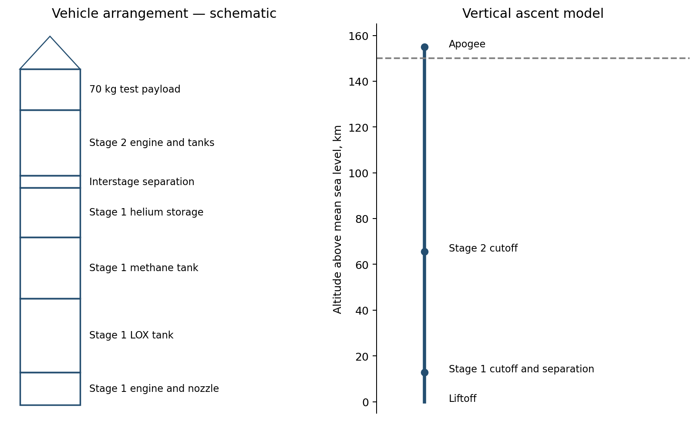
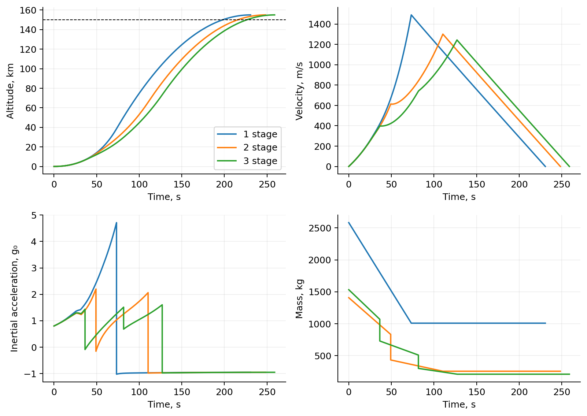
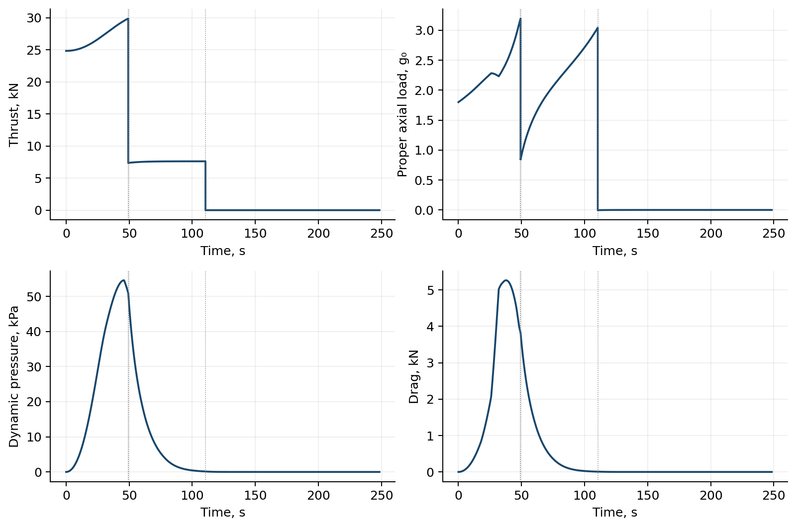
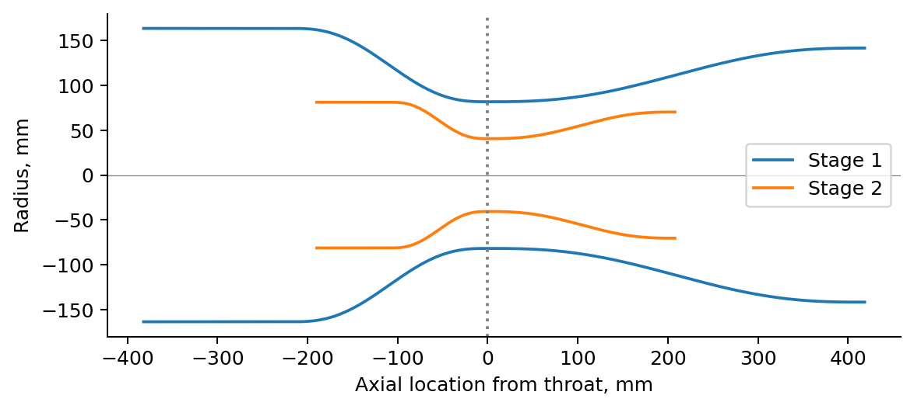
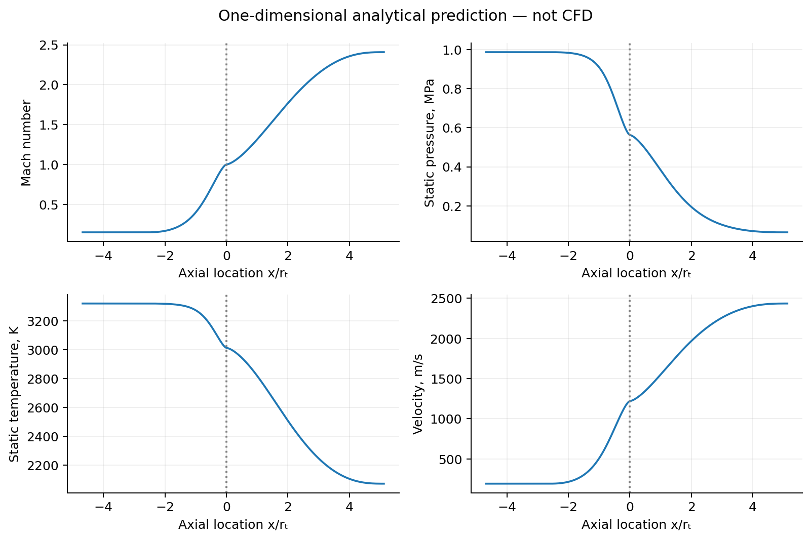
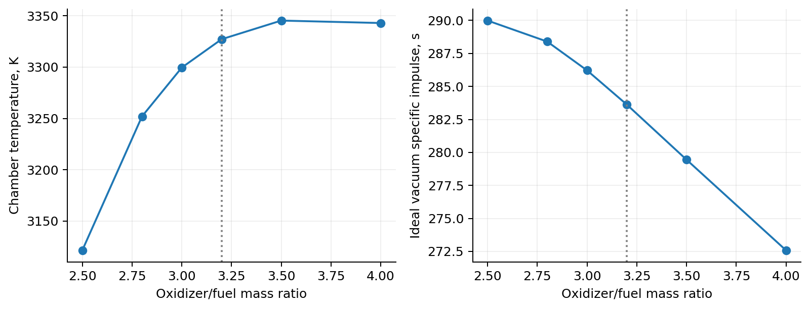
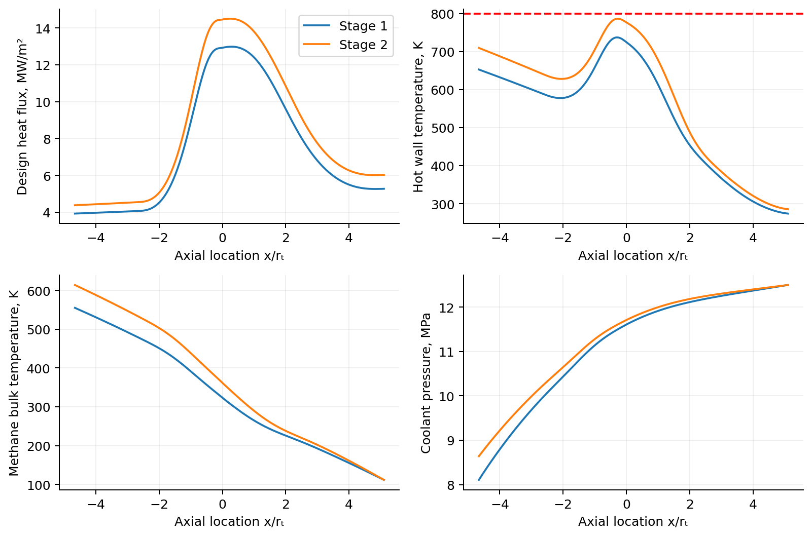
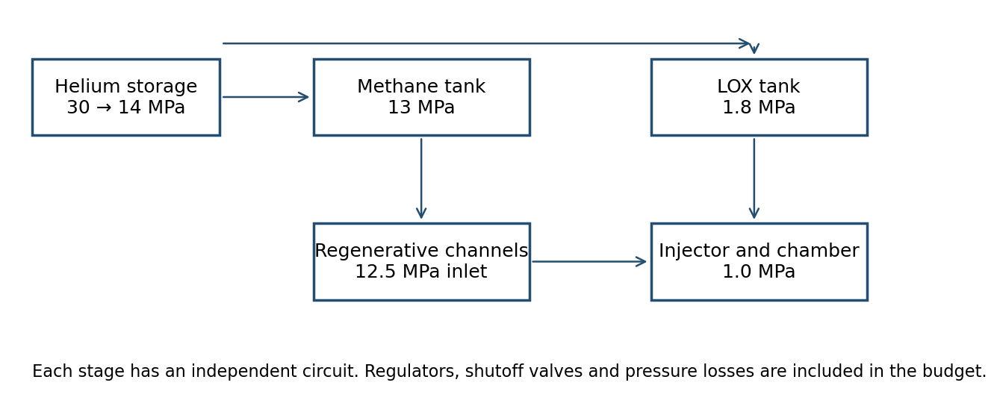
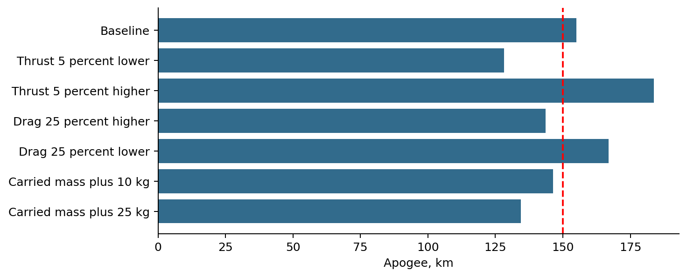

# Preliminary Design of a Two Stage Rocket for a 70 kg Test Payload

Jaeyoon Kim  
Department of Mechanical and Aerospace Engineering  
North Carolina State University  
MAE 459 Rocket Propulsion

## Abstract

**A preliminary two-stage liquid-oxygen and methane rocket is analyzed for a 70 kg passenger-equivalent test payload and a minimum suborbital apogee of 150 km above mean sea level. The personal motivation is a flight to space; the modeled payload is an inert mass equivalent, with no passenger, capsule, life support, or human-flight qualification. A common analytical framework compares one-, two-, and three-stage vehicles, couples equilibrium combustion properties to a constant-property nozzle model, integrates ascent with variable gravity and estimated aerodynamic drag, and estimates regenerative cooling and pressure-fed storage. The selected two-stage case has a calculated liftoff mass of 1407.1 kg, burns 752.1 kg of usable propellant, and reaches a nominal 155.0 km at 248.4 s. Its 2.780 km/s effective vacuum velocity increment includes atmospheric-pressure, gravity, and drag losses. The cooling correlation predicts maximum screening wall temperatures of 737 K and 786 K. These results establish a conditional classroom design, rather than a demonstrated vehicle. The nominal altitude margin is sensitive to thrust, drag, and mass assumptions. Required Fluent nozzle simulations, mesh sensitivity, independent CFD thrust, and quantitative analytical comparisons remain to be performed using the supplied geometry and procedure.**

```{=openxml}
<w:p><w:r><w:br w:type="page"/></w:r></w:p>
```

## Nomenclature

|Symbol|Meaning|SI unit|
|---|---|---|
|$A_t$, $A_e$, $A_c$|Throat, exit, chamber area|m²|
|$A_{ref}$|Vehicle frontal reference area|m²|
|$a$, $a_s$|Inertial acceleration; local sound speed|m/s²; m/s|
|$c^*$|Characteristic velocity|m/s|
|$c_{eff}$|Effective exhaust velocity, F/ṁ|m/s|
|$C_D$, $C_F$|Drag coefficient; thrust coefficient|—|
|$c_p$|Specific heat at constant pressure|J/(kg K)|
|$D$, $D_h$|Drag force; hydraulic diameter|N; m|
|$F$|Thrust|N|
|$g_0$, $g(h)$|Standard; local gravitational acceleration|m/s²|
|$h$, $h_i$|Altitude; species specific enthalpy|m; J/kg|
|$h_g$, $h_c$|Gas-side; effective coolant heat-transfer coefficient|W/(m² K)|
|$I_{sp}$|Specific impulse F/(ṁg₀)|s|
|$M$, $W$|Mach number; molecular weight|—; kg/kmol|
|$m_p$, $m_i$, $m_L$|Usable propellant; burnout inert; carried mass|kg|
|$\dot m$|Propellant mass flow rate|kg/s|
|$O/F$|Oxidizer-to-fuel mass ratio|—|
|$P_c$, $P_a$, $P_e$|Chamber total, ambient, exit static pressure|Pa|
|$q$, $q^{\prime\prime}$|Dynamic pressure; wall heat flux|Pa; W/m²|
|$R$, $R_u$|Specific; universal gas constant|J/(kg K); J/(kmol K)|
|$T_c$, $T_e$|Chamber total; exit static temperature|K|
|$T_{aw}$, $T_w$|Adiabatic wall; gas-side wall temperature|K|
|$v$, $V_e$|Vehicle ascent speed; nozzle exit speed|m/s|
|$\gamma$, $\epsilon$|Specific heat ratio; nozzle area ratio Aₑ/Aₜ|—|
|$\eta_F$|Assumed delivered-to-ideal thrust factor|—|
|$\mu$, $\rho$|Dynamic viscosity; density|Pa s; kg/m³|


The model uses three physical states: $\mathbf{x}=(h,v,m)^T$. Additional integration variables accumulate thrust, gravity, and drag velocity increments. A **stage** is a separable propulsion assembly; a **flight phase** is a powered or coasting interval. These terms are distinct. The final design has two propulsion stages, two powered phases, and one coast to apogee.

In the stage-sizing code, the key named `dry` means burnout inert mass, which includes trapped residual propellant. Physical dry mass is reported separately below. Standard gravity is $g_0=9.80665$ m/s²; Earth radius is $R_E=6.371\times10^6$ m. Rounding in printed tables may cause small apparent summation differences.

```{=openxml}
<w:p><w:r><w:br w:type="page"/></w:r></w:p>
```

## I. Introduction

### A. Project Objective and Scope

The mission is to carry a **70 kg passenger-equivalent test payload to a minimum apogee of 150 km above mean sea level on a suborbital trajectory**. A nominal analytical target of 155 km provides 5 km of design margin. The scope is preliminary ascent and propulsion design. It includes both propulsion stages and all ascent phases through apogee. Recovery, reentry, attitude control design, stability, structural qualification, and human support systems are outside this model.

The assignment requires six connected analyses and explicitly requires CFD [1]. This report develops the numerical and analytical design, then identifies the measurements and evidence that must be added after Fluent is run. Analytical curves are labeled as such throughout. No CFD output or experimental result is represented as completed.

### B. Analysis Approach and Shared Design Inputs

The course rocket-equation, control-volume, compressible-flow, combustion, and heat-transfer methods provide the calculation framework [2–6]. SI units are used unless stated otherwise. All pressures are absolute. Ideal nozzle quantities and the assumed delivered performance are kept separate. The supplied AIAA template controls the document structure; calculations and plots are reproducible from the accompanying scripts.


### C. Requirement Coverage and Remaining Work


**Table I Project requirement coverage**

|Manual requirement|Where addressed|Current status|
|---|---|---|
|Part 1 mission / sketch / ΔV / 1–3 stages / trajectory / drag|II; Appendix A|Analytical baseline complete; drag and mass are assumptions|
|Part 2 engine / geometry / altitude behavior|III.A–C|Analytical baseline complete|
|Part 2 mandatory CFD / mesh / exit / thrust comparison|III.D–G; Appendix B|Pending actual Fluent runs and measured outputs|
|Part 3 propellant / energy / properties / performance|IV|Equilibrium reference and comparisons computed|
|Part 4 heat flux / cooling / feasibility|V|First-order conditional screen; limitations stated|
|Part 5 tanks / feed / losses / consistency|VI|Preliminary sizing; packaging and detailed network unresolved|
|Part 6 one-page table / assumptions / independent checks|VII|Table and independent numerical checks provided|

```{=openxml}
<w:p><w:r><w:br w:type="page"/></w:r></w:p>
```

## II. Mission Trajectory and Staging

### A. Mission Definition and Vehicle Concept


**Table II Mission requirements and baseline choices**

|Requirement or choice|Value and interpretation|
|---|---|
|Useful payload|70 kg inert passenger-equivalent test mass; exceeds 50 kg requirement|
|Required minimum apogee|150 km AMSL; no orbital insertion or horizontal orbital-speed requirement|
|Nominal sizing target|155 km AMSL; 5 km preliminary margin|
|Launch state|h = 0 m AMSL, v = 0 m/s, vertical launch|
|Architecture|Two liquid propulsion stages; instantaneous separation and ignition|
|Vehicle diameter|0.45 m assumed; frontal area 0.15904 m²|
|Chamber / mixture|1.0 MPa total pressure; LOX/CH₄; O/F = 3.2|
|Nozzle / performance|Aₑ/Aₜ = 3; delivered thrust = 0.95 × ideal thrust|
|Initial thrust sizing|Stage 1: sea-level T/W = 1.8; upper stage: vacuum T/W = 1.8|
|Scope boundary|Ascent to apogee; upper stage remains attached to payload|


{width=5.65in}

**Fig. 1 Vehicle arrangement and nominal vertical trajectory. Arrangement is schematic and is not a dimensioned packaging drawing.**

The personal story motivates the 70 kg requirement. Replacing this test payload with a person would change the mission, payload accommodation, mass budget, acceleration constraints, and recovery requirements. The present analysis makes no claim about a human-carrying vehicle.

```{=openxml}
<w:p><w:r><w:br w:type="page"/></w:r></w:p>
```

### B. Mission Velocity Requirement

For a vertical, instantaneous, drag-free surface impulse, conservation of energy gives a useful lower bound:

$$v_{impulse}=\sqrt{2g_0R_E\frac{h_a}{R_E+h_a}}=1695.38\ \mathrm{m/s}\quad(h_a=150\ \mathrm{km}).\qquad\mathrm{(1)}$$

This is not the engine velocity increment: a finite burn loses velocity to gravity, drag, and atmospheric backpressure. The stage mass ratios are sized using an effective vacuum exhaust velocity $c_{eff,vac}=\eta_F I_{sp,vac}g_0=2642.29$ m/s. The converged two-stage sizing value is $\Delta V_{vac}=2779.77$ m/s, allocated equally as 1389.89 m/s per stage.

$$\Delta V_{vac}=\sum_j c_{eff,vac}\ln\!\left(\frac{m_{0,j}}{m_{f,j}}\right).\qquad\mathrm{(2)}$$

The powered-flight integration gives $\int F/m\,dt=2604.21$ m/s, gravity loss 1076.05 m/s, and drag loss 226.86 m/s. Therefore $v_b=2604.21-1076.05-226.86=1301.31$ m/s at 65.672 km. Ambient pressure accounts for the remaining 175.56 m/s between the effective vacuum and integrated thrust increments. At this burnout altitude, only 1264.68 m/s is needed to coast to 150 km in vacuum; the computed trajectory coasts to 155 km with small additional drag.

### C. Comparison of One Two and Three Stages

Each architecture is resized to the same 155 km nominal apogee with the same propulsion assumptions, drag envelope, 70 kg payload, and stage mass law. With $k=0.35/(1-0.35)$ and a 90 kg fixed allowance per stage,

$$m_i=k m_p+90,\qquad r=\exp\left(\frac{\Delta V_{vac}}{n c_{eff,vac}}\right),\qquad m_p=\frac{(r-1)(m_L+90)}{1-k(r-1)}.\qquad\mathrm{(3)}$$

Sizing proceeds from the top stage down. The 0.35 coefficient applies to the scalable portion; it is not the final inert fraction after the fixed allowance. It is an explicit preliminary assumption, checked against the selected stage component budgets.


**Table III Architecture comparison at equal nominal apogee**

|Stages|Liftoff kg|Usable propellant kg|Burnout inert kg|ΔV vacuum m/s|Peak load g₀|
|---|---|---|---|---|---|
|1|2,582.6|1,574.7|937.9|2,486.2|5.70|
|2|1,407.1|752.1|585.0|2,779.8|3.20|
|3|1,532.2|774.9|687.3|2,857.5|2.58|


Two stages reduce liftoff mass by 45.5% relative to one stage and 8.2% relative to three. One stage retains all structure and has the highest peak load. Three stages add another fixed hardware allowance and separation event; lower peak load does not compensate for their higher mass in this comparison. Two stages are selected within this constrained trade. Equal velocity allocation and common expansion ratio were not globally optimized; another mass model or upper-stage nozzle could change the ranking.

```{=openxml}
<w:p><w:r><w:br w:type="page"/></w:r></w:p>
```

### D. Final Stage Mass Budget

Usable propellant is consumed at constant mass flow. Loaded propellant includes 2% unusable residual. The residual is part of burnout inert mass, so it is not counted twice:

$$m_{loaded}=1.02m_p,\qquad m_{dry,physical}=m_i-0.02m_p,\qquad m_0=m_{dry,physical}+m_{loaded}+m_L.\qquad\mathrm{(4)}$$


**Table IV Selected stage mass budget**

|Quantity|Stage 1|Stage 2|
|---|---|---|
|Usable propellant, kg|575.57|176.55|
|Loaded propellant, kg|587.09|180.08|
|Unusable residual, kg|11.51|3.53|
|Physical dry mass, kg|388.41|181.53|
|Burnout inert mass, kg|399.92|185.07|
|Carried mass, kg|431.62|70.00|
|Ignition total mass, kg|1,407.12|431.62|
|Before-separation burnout mass, kg|831.54|255.07|
|Mass ratio m₀/mf|1.6922|1.6922|
|Mass flow, kg/s|11.6895|2.8834|
|Burn duration, s|49.239|61.229|


Stage 1 carries the entire 431.62 kg upper-stage assembly, including its 70 kg useful payload. Stage 2 carries only the 70 kg useful payload in the rocket equation. At first-stage separation, 399.92 kg is discarded; position and velocity remain continuous while mass changes discontinuously. The upper stage is retained during coast, giving 255.07 kg at apogee.

Physical dry mass includes structure, engine, tanks, feed hardware, pressurization hardware and gas, and unused design allowance. A component-based allocation appears in Section VI. The mass model is a preliminary closure, not a measured vehicle mass. The unused allowance must absorb eventual changes in packaging, stability hardware, insulation, joints, and load-bearing structure.

The distinction between payload and carried mass matters: using 70 kg as the stage-1 carried mass would omit the entire upper stage and substantially underpredict the vehicle size.

```{=openxml}
<w:p><w:r><w:br w:type="page"/></w:r></w:p>
```

### E. Trajectory and Aerodynamic Model

The vertical point-mass equations during powered ascent are

$$\dot h=v,\qquad \dot v=\frac{F-D}{m}-g_0\left(\frac{R_E}{R_E+h}\right)^2,\qquad \dot m=-\dot m_p.\qquad\mathrm{(5)}$$

$$F(h)=\eta_F[\dot m_p V_e+(P_e-P_a(h))A_e],\qquad D=\tfrac12\rho(h)v|v|C_D(M)A_{ref}.\qquad\mathrm{(6)}$$

During coast, $F=0$ and $\dot m=0$. The terminal condition is a downward crossing of $v=0$. Separation has no velocity impulse or delay. Rotation, winds, steering, angle of attack, and lateral motion are neglected. Proper axial load is $(F-D)/(mg_0)$; inertial acceleration is $\dot v$. They differ by local gravity. Neither is a passenger qualification criterion here.

Lower-atmosphere pressure and temperature use the U.S. Standard Atmosphere layer relations through 84.852 km geopotential altitude [7]. The conversion is $H=R_Eh/(R_E+h)$. Above that level, an exponential low-density continuation is used rather than a full thermosphere model. Most drag occurs well below this boundary; high-altitude Mach numbers from the continuation should not be treated as atmospheric measurements.

The aerodynamic coefficient is a declared preliminary envelope, linearly interpolated between the following points. It represents a transonic increase and a supersonic decline, not validated data for this geometry. Mach and Reynolds-number similarity matter when replacing this assumption with aerodynamic measurements or CFD [8].


**Table V Assumed drag coefficient envelope**

|Mach|0|0.5|0.8|1.05|1.2|2|3|5|10|
|---|---|---|---|---|---|---|---|---|---|
|Powered Cᴅ|0.35|0.35|0.42|0.75|0.70|0.48|0.38|0.32|0.30|


During coast, 0.10 is added to the envelope for an assumed base-drag increase. Values outside the table are held at the endpoints. The fixed frontal area is 0.15904 m². This does not account explicitly for skin friction, fins, stage joints, or the long tank and pressurant packaging; those omissions are a major uncertainty. A ±25% drag sensitivity is reported, but it is not a proven uncertainty bound.

The scripts integrate with an adaptive Runge–Kutta method, relative tolerance $2\times10^{-9}$, absolute tolerance $10^{-8}$, and maximum step 0.25 s. Halving the maximum step changes apogee by 0.0025 m, far below physical-model uncertainty. The detailed histories are supplied as CSV files.

```{=openxml}
<w:p><w:r><w:br w:type="page"/></w:r></w:p>
```

### F. Trajectory Results and Mission Closure


**Table VI Selected trajectory events**

|Event|Time s|Altitude km|Speed m/s|Mass kg|
|---|---|---|---|---|
|Liftoff|0.000|0.000|0.00|1,407.12|
|S1 burnout|49.239|12.916|614.06|831.54|
|S1 separation / stage 2 ignition|49.239|12.916|614.06|431.62|
|S2 burnout|110.468|65.672|1,301.31|255.07|
|Apogee|248.409|155.000|-0.00|255.07|


{width=6.2in}

**Fig. 2 Calculated altitude, speed, inertial acceleration, and mass for all three preliminary architectures.**

The final architecture reaches 155.0 km at 248.41 s. Powered flight lasts 110.47 s, followed by 137.94 s of coast. The 1-, 2-, and 3-stage cases all reach the same nominal target because each is independently resized. Their different loss histories explain why their required velocity increments differ.

```{=openxml}
<w:p><w:r><w:br w:type="page"/></w:r></w:p>
```

### F. Trajectory Results and Mission Closure continued

{width=6.2in}

**Fig. 3 Two-stage thrust, proper axial load, dynamic pressure, and drag histories. Vertical markers indicate stage events.**

Maximum dynamic pressure is 54.57 kPa at 45.83 s and 10.94 km. Maximum drag is 5.26 kN at 37.81 s and 7.12 km. Peak proper axial load is 3.196 $g_0$ immediately before first-stage cutoff; the corresponding inertial acceleration is 21.57 m/s², or 2.200 $g_0$.

Immediately after separation and upper-stage ignition, inertial acceleration is −1.54 m/s² despite positive thrust. The smaller upper-stage engine initially cannot overcome gravity plus the remaining drag at that speed. The vehicle continues upward because its speed is still 614.06 m/s; the lower atmospheric density and declining mass subsequently allow acceleration to become positive. This transition is a model result that must be retained rather than smoothed away.

The nominal 5 km altitude margin is only 3.33% of the minimum requirement. It is not a demonstrated reliability margin. Section VII shows that a 5% thrust reduction or a 25% drag increase misses the 150 km requirement. The nominal pass must therefore be stated together with its assumptions.

```{=openxml}
<w:p><w:r><w:br w:type="page"/></w:r></w:p>
```

## III. Rocket Engine and Nozzle

### A. Chamber Conditions and Operating Point

Both stages use the same chamber total pressure, equilibrium reference temperature, mixture ratio, and dimensionless nozzle contour. Stage-specific throat sizes set the required flow. The 1.0 MPa chamber pressure is a classroom design choice that limits chamber pressure loading; regenerative pressure losses still require much higher fuel storage pressure. The gas properties are calculated in Section IV, rather than selected independently.


**Table VII Common chamber and gas properties**

|Parameter|Common value|
|---|---|
|Chamber total pressure P꜀|1.000 MPa absolute|
|Chamber total temperature T꜀|3,327.16 K|
|O/F mass ratio|3.200|
|Molecular weight|20.37175 kg/kmol|
|Specific gas constant|408.137 J/(kg K)|
|Frozen chamber cₚ|2,357.80 J/(kg K)|
|Specific heat ratio γ|1.209337|
|Area ratio Aₑ/Aₜ|3.000|
|Delivered thrust factor ηꜰ|0.950 assumed; not CFD-derived|


The nozzle model is steady, one dimensional, adiabatic, isentropic, and calorically perfect, with chamber-frozen composition and constant $c_p$ and $\gamma$. It neglects boundary-layer displacement, finite-rate chemistry, divergence, shocks, and wall heat loss. The 0.95 delivered-thrust factor is a lumped preliminary allowance, not a separately validated efficiency for each loss mechanism [4,9].

### B. Nozzle Geometry and Analytical Performance

$$\frac{A}{A_t}=\frac1M\left(\frac2{\gamma+1}\left(1+\frac{\gamma-1}{2}M^2\right)\right)^{\frac{\gamma+1}{2(\gamma-1)}}.\qquad\mathrm{(7)}$$

$$T_e=\frac{T_c}{1+(\gamma-1)M_e^2/2},\quad P_e=P_c(T_e/T_c)^{\gamma/(\gamma-1)},\quad V_e=M_e\sqrt{\gamma R T_e}.\qquad\mathrm{(8)}$$

$$c^*=\sqrt{\frac{RT_c}{\gamma}}\left(\frac{\gamma+1}{2}\right)^{\frac{\gamma+1}{2(\gamma-1)}},\quad A_t=\frac{\dot m c^*}{P_c},\quad C_F=\frac{F}{P_cA_t},\quad I_{sp}=\frac{F}{\dot m g_0}.\qquad\mathrm{(9)}$$

Using the supersonic root of Eq. (7) gives $M_e=2.40779$, $P_e=64.5866$ kPa, $T_e=2070.66$ K, $V_e=2434.17$ m/s, and $c^*=1791.85$ m/s. The ideal coefficients are $C_{F,SL}=1.24825$ and $C_{F,vac}=1.55223$. Throat conditions are $M_t=1$, $T_t=3011.91$ K, $P_t=562.664$ kPa, and $\rho_t=0.457722$ kg/m³.

```{=openxml}
<w:p><w:r><w:br w:type="page"/></w:r></w:p>
```

### B. Nozzle Geometry and Analytical Performance continued


**Table VIII Stage engine and nozzle performance**

|Quantity|Stage 1|Stage 2|
|---|---|---|
|Total flow, kg/s|11.6895|2.8834|
|Methane flow, kg/s|2.7832|0.6865|
|LOX flow, kg/s|8.9063|2.1969|
|Throat area, m²|0.0209458|0.0051667|
|Exit area, m²|0.0628374|0.0155001|
|Throat diameter, mm|163.307|81.108|
|Exit diameter, mm|282.855|140.482|
|Chamber diameter, mm|326.613|162.215|
|Ideal sea-level thrust, kN|26.146|6.449|
|Ideal vacuum thrust, kN|32.513|8.020|
|Delivered sea-level thrust, kN|24.838|6.127|
|Delivered vacuum thrust, kN|30.887|7.619|
|Ideal Isp sea level / vacuum, s|228.08 / 283.62|228.08 / 283.62|
|Delivered Isp sea level / vacuum, s|216.67 / 269.44|216.67 / 269.44|


The upper stage ignites at 12.916 km, where ambient pressure is 16.800 kPa. Its ideal ignition thrust is 7.759 kN and assumed delivered thrust is 7.372 kN. The sea-level upper-stage values are reference comparisons, not a second sea-level launch.

The geometry uses a short cylindrical chamber, a smooth contraction, and a smooth divergent wall. Let $r_t=\sqrt{A_t/\pi}$, $r_c=2r_t$, $r_e=\sqrt3r_t$, and $s(z)=10z^3-15z^4+6z^5$. The contraction is $r=r_c-(r_c-r_t)s(z)$; the divergence is $r=r_t+(r_e-r_t)s(z)$. Each segment has $0\leq z\leq1$. The throat is at $x=0$.

Lengths are $L_{ch}=2r_t$, $L_c=1.875(r_c-r_t)/\tan35^\circ$, and $L_d=1.875(r_e-r_t)/\tan15^\circ$. The factor 1.875 is the maximum derivative of $s(z)$, so these angles are maximum local wall angles, not conical half angles. The smooth contour makes the analytical geometry unambiguous and provides zero slope at the segment endpoints. It is a chosen contour, not an optimized bell nozzle.

The characteristic chamber lengths follow from the selected geometry; sufficient residence time and injector mixing are not independently established. Chamber combustion CFD and injector development are not included. The supplied STEP files contain fluid surfaces only, not manufactured engine solids.

```{=openxml}
<w:p><w:r><w:br w:type="page"/></w:r></w:p>
```

### B. Nozzle Geometry and Analytical Performance continued

{width=5.6in}

**Fig. 4 Scaled chamber and nozzle contours. The CFD model uses only the upper half-plane as an axisymmetric fluid face.**


**Table IX Chamber and nozzle dimensions**

|Dimension|Stage 1|Stage 2|
|---|---|---|
|Cylindrical chamber length, mm|163.31|81.11|
|Contraction length, mm|218.65|108.59|
|Divergent length, mm|418.28|207.74|
|Total fluid-domain length, mm|800.23|397.44|
|Characteristic chamber length V꜀/Aₜ, m|1.176|0.584|


{width=4.4in}

**Fig. 5 One-dimensional analytical distributions for the common dimensionless contour. These curves are not CFD evidence.**

```{=openxml}
<w:p><w:r><w:br w:type="page"/></w:r></w:p>
```

### C. Performance Across Altitude

For fixed chamber conditions and geometry, the ideal internal supersonic solution has approximately constant exit state while thrust changes through $(P_e-P_a)A_e$. An exit pressure above ambient is underexpanded; below ambient is overexpanded. The selected nozzle is mildly overexpanded at sea level ($P_e/P_a=0.637$), approximately matched in the lower atmosphere near 3.6 km, and underexpanded at higher altitude. The upper stage is underexpanded throughout its powered trajectory.


**Table X Ideal performance across altitude**

|Altitude km|Ambient kPa|Ideal Isp s|Stage 1 ideal F kN|Stage 2 ideal F kN|
|---|---|---|---|---|
|0.000|101.325|228.08|26.146|6.449|
|5.000|54.048|253.99|29.116|7.182|
|10.000|26.500|269.09|30.847|7.609|
|12.916|16.800|274.41|31.457|7.759|
|30.000|1.197|282.96|32.437|8.001|
|66.000|0.009|283.61|32.512|8.020|


The following area-ratio screening holds chamber properties fixed. It quantifies the compromise between sea-level and vacuum performance.


**Table XI Expansion ratio screening**

|Aₑ/Aₜ|Exit M|Exit pressure kPa|Ideal Isp SL s|Ideal Isp vacuum s|
|---|---|---|---|---|
|2|2.062|119.33|230.70|267.72|
|3|2.408|64.59|228.08|283.62|
|5|2.802|31.28|207.28|299.85|
|8|3.145|16.47|164.06|312.17|


An area ratio of 3 sacrifices 16.23 s of ideal vacuum specific impulse relative to 5 but gains 20.80 s at sea level in this ideal screening. It limits nozzle diameter and reduces the sea-level overexpansion severity. For the upper stage, a larger area ratio could improve performance; using the same ratio simplifies the preliminary geometry and comparison but leaves optimization potential.

At sufficiently unfavorable backpressure, shock-induced boundary-layer separation can alter wall pressure, thrust, and side loads. The sea-level exit-to-ambient ratio alone cannot prove that separation is absent. An inviscid internal-nozzle calculation cannot represent viscous separation. In a supersonic exit, an outlet boundary generally extrapolates the interior state; merely changing outlet pressure does not necessarily simulate the external plume or a separated nozzle. Any claim about separation requires a viscous calculation with adequate near-wall resolution and, where necessary, an external plume domain [10,11].

```{=openxml}
<w:p><w:r><w:br w:type="page"/></w:r></w:p>
```

### D. CFD Domain Mesh and Physical Models

**CFD status: not yet run.** This section defines the required verification cases. Replace the pending results in Sections III.E–G with measured Fluent data after following Appendix B. The report cannot yet claim completion of the assignment's required CFD component.

The baseline is a steady, compressible, two-dimensional **axisymmetric** calculation of the final chamber and nozzle fluid face for each stage. The $x$ direction is axial; radial coordinate $y\geq0$; the lower edge is the axis. Use the energy equation and a custom ideal-gas material with constant $c_p=2357.80$ J/(kg K) and molecular weight 20.37175 kg/kmol. Fluent then has $R=408.1368$ J/(kg K) and $\gamma=1.209337$. Do not use default air or treat the geometry as planar [10,11].

Use an inviscid wall for the initial comparison to the analytical model. This isolates multidimensional geometry and numerical effects. It does not verify regenerative heat transfer, skin friction, or separation. A subsequent viscous SST calculation is useful for estimating losses, but must be separately identified, with its wall treatment and material properties documented.


**Table XII Planned CFD boundary conditions**

|Setting|Stage 1 baseline|Stage 2 baseline|
|---|---|---|
|Inlet total pressure|1,000,000 Pa|1,000,000 Pa|
|Inlet total temperature|3327.1648 K|3327.1648 K|
|Operating pressure|0 Pa|0 Pa|
|Outlet ambient pressure|101,325 Pa|16,799.695 Pa|
|Inlet flow direction|Normal into chamber|Normal into chamber|
|Wall / axis|Inviscid slip wall / axis|Inviscid slip wall / axis|
|Gas model|Ideal gas; constant cₚ and W|Same|
|Solver starting point|Double precision, density-based, steady|Same|
|Grid sequence|Coarse, medium, fine|Coarse, medium, fine|


Do not prescribe both the target mass flow and the total inlet state as independent constraints. The throat and chamber total state should determine the choked mass flow; compare the resulting flow with the design values. For pressure-inlet initialization, a chamber static-pressure estimate near 0.99 MPa is appropriate; it is not a second imposed stagnation pressure.

### E. Convergence and Mesh Adequacy

Start with approximately 10,000, 40,000, and 160,000 cells per stage, with comparable topology and refinement in both directions. These are planned targets, not actual mesh counts. Refine the throat, curved wall, and exit. Record cell count and mesh quality. Require stable mass flow and thrust as well as low residuals. Suggested criteria are residuals ≤10⁻⁶, energy ≤10⁻⁸, mass imbalance below 0.1%, and less than 0.1% monitor variation over the last 200 iterations. If these are not achieved, report the actual behavior and resolve it before claiming convergence.

```{=openxml}
<w:p><w:r><w:br w:type="page"/></w:r></w:p>
```

### F. CFD Flow Fields and Exit Quantities

For each final-stage nozzle, save Mach, static pressure, static temperature, density, velocity magnitude, and wall-pressure plots with units and readable legends. Include mesh and convergence evidence. Contours must be accompanied by measured exit data. The pending table is intentionally unfilled.


**Table XIII Analytical reference and pending CFD results**

|Quantity|1-D analytical value|Stage 1 CFD fine|Stage 2 CFD fine|
|---|---|---|---|
|Exit Mach, mass-weighted|2.40779|Pending|Pending|
|Exit static pressure, area-weighted|64,586.62 Pa|Pending|Pending|
|Exit static temperature, mass-weighted|2070.66 K|Pending|Pending|
|Exit speed, mass-weighted|2434.17 m/s|Pending|Pending|
|Mass flow|11.68951 / 2.88344 kg/s|Pending|Pending|
|Exit density, analytical|0.07642 kg/m³|Pending|Pending|
|Ideal thrust at case ambient|26,145.66 / 7759.49 N|Pending|Pending|


Report each grid's measured values and the medium-to-fine change, not just the final fine-grid result. Define the grid change for any quantity $\phi$ as $100|\phi_f-\phi_m|/|\phi_f|$. A target below 1% for thrust and the four required exit quantities is a practical starting criterion; also inspect wall-pressure and shock-location changes. A single nearly unchanged integral does not prove all flow features are resolved.

### G. Independent Thrust Comparison and Interpretation

Compute ideal analytical thrust using Eq. (6) with $\eta_F=1$. Independently obtain gross nozzle thrust from the CFD exit-plane momentum and pressure flux [9,12]:

$$F_{CFD}=\int_{A_e}\left(\rho u_x^2+(p-P_a)\right)\,dA,\qquad dA=2\pi r\,dr.\qquad\mathrm{(10)}$$

The plane normal is axial. Use axial velocity in the momentum term; velocity magnitude is a separate reported exit quantity. Integrate the local product $\rho u_x^2$, rather than multiplying independently averaged density and velocity. Fluent's axisymmetric integrals should already represent the revolved area; verify that its reported exit area equals the analytical $A_e$ and do not multiply by $2\pi$ twice. Pressure is absolute because operating pressure is zero.

For each comparison, report $100(\phi_{CFD}-\phi_{1D})/\phi_{1D}$ and its absolute magnitude. Compare the inviscid CFD result with the **ideal** analytical result, not the 0.95-corrected flight thrust. Explain differences using multidimensional velocity, wall turning, numerical dissipation, residual convergence, and grid resolution. For a viscous model, add boundary-layer displacement and shear; for a different gas model, add variable-property and chemistry effects. Agreement between two calculations with shared assumptions is numerical verification, not experimental validation.

```{=openxml}
<w:p><w:r><w:br w:type="page"/></w:r></w:p>
```

## IV. Combustor and Propellant Selection

### A. Fuel Oxidizer and Mixture Ratio

Liquid methane and liquid oxygen are selected to provide a calculable gaseous combustion system and allow methane regenerative cooling. Their storage and feed penalties are explicitly included. O/F = 3.2 is fuel rich relative to the complete-combustion value of 4 for CH₄ + 2O₂. It is a compromise, not an asserted optimum. Relative to O/F = 2.5, the fuel fraction falls from 28.57% to 23.81%, reducing the high-pressure fuel inventory by 16.7% for a fixed total propellant mass. The ideal specific-impulse penalty is quantified below.

### B. Combustion Energy and Thermodynamic Properties

The chamber reference state is computed by constant-enthalpy, constant-pressure equilibrium with Cantera 3.2.0 and the GRI-Mech 3.0 species thermodynamic data [13,14]. This is an ideal-gas equilibrium estimate; it does not resolve injector mixing, combustion instability, soot formation, or finite-rate residence-time limits. CoolProp supplies cold-liquid property differences [15]. To avoid mixing arbitrary enthalpy zero points, each reactant enthalpy is mapped onto the Cantera reference:

$$h_{i,in}=h^{CT}_i(T_{ref},P_{ref})+[h^{CP}_i(T_i,P_i)-h^{CP}_i(T_{ref},P_{ref})].\qquad\mathrm{(11)}$$

Here $T_{ref}=298.15$ K and $P_{ref}=101325$ Pa. The cold feed states are CH₄ at 111.7 K and 13 MPa, and O₂ at 90.2 K and 1.8 MPa. Their mapped enthalpies are −5.540435 and −0.403451 MJ/kg. The cold-mixture enthalpy is

$$h_{cold}=\frac{h_f+(O/F)h_o}{1+O/F}=-1.626542\ \mathrm{MJ/kg}.\qquad\mathrm{(12)}$$

A common preliminary regenerative return of 0.400 MJ/kg of total propellant is added, giving the adiabatic chamber target $h_{in}=-1.226542$ MJ/kg. Equilibrium at 1 MPa gives $T_c=3327.16$ K. The product enthalpy is −1.226542086 MJ/kg, with a numerical balance residual of 0.0026 J/kg. Starting from cold reactants without heat return gives 3283.13 K. The relatively small temperature increase despite added enthalpy reflects changing equilibrium composition and dissociation; it should not be estimated simply as $\Delta h/c_p$ at fixed composition.

For a real cooled chamber, the control-volume balance is $\dot m h_{products}=\dot m h_{reactants}+\dot Q_{regen}-\dot Q_{wall,chamber}$, with kinetic and work terms neglected. The quoted $T_c$ is an adiabatic reference for the heated inlet stream, not a solved conjugate chamber temperature. Heat extracted downstream is internal recovery, not an external energy source. The nozzle and cooling estimates are therefore loosely coupled; the delivered-thrust allowance does not prove that this coupling is exact.

```{=openxml}
<w:p><w:r><w:br w:type="page"/></w:r></w:p>
```

### B. Combustion Energy and Thermodynamic Properties continued


**Table XIV Major equilibrium product species**

|Major product species|Equilibrium mole fraction|
|---|---|
|H2O|0.438591|
|CO|0.202543|
|H2|0.111212|
|CO2|0.099791|
|OH|0.068121|
|H|0.041558|
|O2|0.023067|
|O|0.015055|


The chamber-frozen viscosity is $9.8012\times10^{-5}$ Pa s, conductivity is 0.39257 W/(m K), and Prandtl number is 0.58866. These are model-derived properties for the calculated mixture. Constant-property nozzle calculations freeze the chamber $c_p$, $R$, and $\gamma$; the heat-transfer estimate updates viscosity at an arithmetic mean gas/wall temperature.

### C. Quantitative Effect on Propulsion Performance


**Table XV Mixture ratio screening**

|O/F|T꜀ K|W kg/kmol|γ|c* m/s|Ideal vacuum Isp s|
|---|---|---|---|---|---|
|2.5|3,121.6|18.128|1.2197|1,834.3|289.99|
|2.8|3,252.0|19.189|1.2137|1,822.9|288.39|
|3.0|3,299.6|19.809|1.2111|1,808.6|286.21|
|3.2|3,327.2|20.372|1.2093|1,791.8|283.62|
|3.5|3,345.3|21.130|1.2076|1,765.1|279.45|
|4.0|3,343.0|22.220|1.2060|1,721.5|272.58|


{width=4.5in}

**Fig. 6 Calculated mixture-ratio screening at 1 MPa, area ratio 3, and the same assumed heat return.**

From O/F = 2.5 to 3.2, temperature rises by 6.59%, but molecular weight rises by 12.38%; $c^*$ decreases by 2.31% and ideal vacuum $I_{sp}$ decreases by 2.20%. Higher flame temperature alone therefore does not imply higher propulsion performance. The approximate dependence $c^*\propto\sqrt{T_c/W}$, modified by $\gamma$, explains the trend. O/F = 3.2 is retained for the fuel-storage compromise; a complete mass optimization over mixture ratio remains future work.

```{=openxml}
<w:p><w:r><w:br w:type="page"/></w:r></w:p>
```

### C. Quantitative Effect on Propulsion Performance continued

For a contrasting fuel, the same calculation is repeated for hydrogen/oxygen at O/F = 6, 1 MPa chamber pressure, area ratio 3, and the same 0.400 MJ/kg heat-return assumption. Hydrogen enters at 20.4 K and 13 MPa in the enthalpy calculation. This is a thermodynamic comparison, not a completed alternative engine or cooling design.


**Table XVI Propellant thermodynamic comparison**

|Quantity|CH₄/O₂ selected|H₂/O₂ screening|
|---|---|---|
|O/F|3.2|6.0|
|Chamber temperature, K|3,327.16|3,303.41|
|Molecular weight, kg/kmol|20.3718|13.0522|
|Specific heat ratio|1.209337|1.204838|
|c*, m/s|1,791.85|2,233.57|
|Ideal vacuum Isp, s|283.62|353.72|


Hydrogen gives approximately 24.7% higher $c^*$ and 24.7% higher ideal vacuum specific impulse here because its much lower product molecular weight outweighs its slightly lower temperature. This benefit comes with a different storage problem. As an illustrative liquid-volume comparison, methane density is 433.25 kg/m³ at 111.7 K and 13 MPa, whereas hydrogen density is 72.91 kg/m³ at 20.4 K and 1.8 MPa. These are explicitly different storage conditions, not equal-pressure density measurements. At the selected mixture ratios, the fuel-volume contribution per kilogram of total propellant is about 0.000550 m³ for methane and 0.001959 m³ for hydrogen, a factor of 3.57. This comparison does not size hydrogen pressurization or its tank insulation.

An independent frozen-composition nozzle calculation uses temperature-dependent Cantera enthalpy and entropy rather than constant-$\gamma$ equations. It enforces $s=s_c$, $V^2/2=h_c-h$, choking at $V=a_s$, and equal mass flux through the prescribed area ratio. It returns $M_e=2.41370$, $P_e=63.247$ kPa, $T_e=2027.83$ K, $V_e=2435.61$ m/s, and $c^*=1790.89$ m/s.

Relative to the constant-property model, the exit temperature changes by −2.07%, pressure by −2.07%, velocity by +0.059%, Mach number by +0.245%, and $c^*$ by −0.053%. This supports the constant-property model as a useful baseline for ideal thrust, while showing that matching velocity does not guarantee matching temperature. Both methods freeze composition through the nozzle; an equilibrium-expansion or finite-rate model could differ further.

```{=openxml}
<w:p><w:r><w:br w:type="page"/></w:r></w:p>
```

## V. Heat Transfer and Cooling

### A. Gas Side Heat Flux and Peak Heating

The gas-side estimate follows the modified Bartz form presented in the heat-transfer lecture [6]. With local diameter $D$, mean gas/wall temperature $T_{am}=(T+T_w)/2$, and gas properties as defined in the course,

$$h_g=\frac{0.026}{D^{0.2}}\frac{\mu_0^{0.2}c_{p,0}}{Pr_0^{0.6}}(\rho V)^{0.8}\left(\frac{\rho_{am}}\rho\right)^{0.8}\left(\frac{\mu_{am}}{\mu_0}\right)^{0.2}.\qquad\mathrm{(13)}$$

The ideal-gas density ratio at the same local pressure is $\rho_{am}/\rho=T/T_{am}$. Viscosity at $T_{am}$ is evaluated with the frozen product mixture. The turbulent recovery estimate is

$$T_{aw}=T\left(1+Pr^{1/3}\frac{\gamma-1}{2}M^2\right),\qquad q^{\prime\prime}=h_g(T_{aw}-T_w).\qquad\mathrm{(14)}$$

The peak occurs near the throat because the local mass flux rises sharply as area contracts, increasing $h_g$. The calculated peak is slightly downstream: 22.66 mm for stage 1 and 9.52 mm for stage 2. Its precise location depends on wall temperature, local properties, contour, and the correlation. It is not inferred solely from maximum gas temperature, which is near the chamber.


**Table XVII Thermal screening results**

|Thermal quantity|Stage 1|Stage 2|
|---|---|---|
|Maximum base heat flux, MW/m²|10.819|12.086|
|Maximum design heat flux, MW/m²|12.983|14.503|
|Maximum design wall temperature, K|737.07|786.24|
|Total design heat pickup, MW|4.321|1.199|
|Peak hɡ, W/(m² K)|4115|4691|
|Adiabatic wall temperature range, K|3124–3326|3124–3326|


A 20% heat-flux multiplier is applied for preliminary model scatter and unmodeled radiation. It is a design allowance, not a calculated radiative-transfer solution or a validated safety factor. Peak wall temperature and peak heat flux need not occur at the same position because coolant temperature changes along the channel.

```{=openxml}
<w:p><w:r><w:br w:type="page"/></w:r></w:p>
```

### B. Cooling Strategy and First Order Feasibility

All methane passes counterflow from the nozzle exit toward the chamber through regenerative channels before injection. A 1 mm copper liner with assumed conductivity 300 W/(m K) separates gas and coolant. An outer jacket carries pressure. The simplified rectangular channels have 1 mm width and an assumed effective fin factor of 0.85. Their count is chosen using approximately 2 mm pitch at the throat; depth gives a coolant mass flux of 8500 kg/(m² s).

$$Re=\frac{G D_h}{\mu_c},\quad Pr_c=\frac{c_{p,c}\mu_c}{k_c},\quad h_c=0.85\frac{k_c}{D_h}(0.023Re^{0.8}Pr_c^{0.4}).\qquad\mathrm{(15)}$$

$$q^{\prime\prime}=\frac{T_w-T_{cool}}{t_w/k_w+1/h_c}=h_g(T_{aw}-T_w).\qquad\mathrm{(16)}$$

The wall temperature is solved at each axial segment. The design heat flux is $1.2q^{\prime\prime}$, and a resistance estimate gives the corresponding design wall temperature. Coolant enthalpy increases by $d\dot Q/\dot m_f$ along the channel. CoolProp evaluates local coolant properties. A Darcy friction estimate uses $f_D=0.3164Re^{-0.25}$.


**Table XVIII Cooling geometry and pressure estimates**

|Cooling input or result|Stage 1|Stage 2|
|---|---|---|
|Channel count|256|127|
|Width × depth, mm|1.000 × 1.279|1.000 × 0.636|
|Hydraulic diameter, mm|1.122|0.777|
|Methane flow, kg/s|2.7832|0.6865|
|Inlet pressure / temperature|12.5 MPa / 111.7 K|12.5 MPa / 111.7 K|
|Outlet bulk temperature, K|556.03|614.97|
|Friction pressure loss, MPa|4.431|3.891|
|Acceleration-loss estimate, MPa|2.446|2.559|
|Remaining pressure after both, MPa|5.624|6.050|


The predicted wall temperatures are below an assumed 800 K screening limit, leaving only 13.8 K for stage 2. This is a narrow first-order thermal margin. The limit is a design assumption, not a certified copper strength limit. Material strength, cyclic fatigue, pressure stresses, and local hot spots require separate checks. These results demonstrate a candidate cooling approach, not verified thermal feasibility under all uncertainties.

```{=openxml}
<w:p><w:r><w:br w:type="page"/></w:r></w:p>
```

### C. Coupling and Thermal Limitations

{width=6.2in}

**Fig. 7 Correlation-based regenerative cooling estimates. Pressure curves include friction; the separate acceleration allowance is reported in the table.**

The thermal estimates return 0.3697 and 0.4158 MJ/kg of total propellant to the stage-1 and stage-2 feeds. Repeating the equilibrium calculation with these values gives 3323.92 and 3328.86 K, within 3.25 K of the common 3327.16 K reference. This checks the scale of the assumed regenerative return. It does not close the chamber-wall and nozzle-wall energy distribution exactly. A fully coupled calculation would subtract local heat removal from the gas, update total enthalpy along the nozzle, and iterate coolant and gas states together.

The pressure march initially includes friction only. A separate estimate $\Delta P_{acc}=G^2(1/\rho_{out}-1/\rho_{in})$ accounts for coolant acceleration as density falls. It reduces available pressure by another 2.45–2.56 MPa. That estimate is not fed back through a compressible channel solver, so the reported outlet temperature and wall temperature remain screening values.

Reynolds numbers range from about $4.9\times10^4$ to $6.6\times10^5$. Bulk coolant speed reaches approximately 305–319 m/s. Property variation near the methane pseudo-critical region, compressibility, developing flow, roughness, manifold losses, thermal stress, and possible local heat-transfer deterioration limit the simple Dittus–Boelter/Blasius approach. The published methane equation-of-state range extends to 625 K; the 615 K stage-2 estimate approaches that upper boundary [16]. A larger margin or higher-fidelity channel analysis is needed before treating cooling as confirmed.

```{=openxml}
<w:p><w:r><w:br w:type="page"/></w:r></w:p>
```

## VI. Feed System and Other Components

### A. Propellant Inventory and Tank Sizing

The propellant split is $m_f=m_p/(1+O/F)$ and $m_o=(O/F)m_f$. Tank volume includes 2% residual and 5% ullage:

$$V_{tank}=\frac{1.02m_{usable}}{0.95\rho_{storage}}.\qquad\mathrm{(17)}$$

Methane density is 433.253 kg/m³ at 111.7 K and 13 MPa; LOX density is 1144.862 kg/m³ at 90.2 K and 1.8 MPa [15]. The strong fuel-pressure requirement originates in the cooling channels, not the 1 MPa chamber alone.


**Table XIX Propellant inventory and tank volume**

|Stage and fluid|Usable kg|Loaded kg|Volume L|Pressure MPa|Tank length m|
|---|---|---|---|---|---|
|1 Fuel|137.04|139.78|339.62|13.0|3.457|
|1 Oxidizer|438.53|447.30|411.27|1.8|4.160|
|2 Fuel|42.04|42.88|104.17|13.0|1.143|
|2 Oxidizer|134.52|137.21|126.15|1.8|1.359|


For a preliminary packaging estimate, each propellant tank is a cylinder with hemispherical ends and internal radius 0.18 m:

$$V=\pi r^2L_{cyl}+\tfrac43\pi r^3,\qquad t_{cyl}=\frac{Pr}{\sigma_{allow}},\qquad t_{end}=\frac{Pr}{2\sigma_{allow}}.\qquad\mathrm{(18)}$$

Using an assumed allowable stress of 180 MPa and aluminum density 2700 kg/m³ gives fuel cylinder/end thicknesses of 13.0/6.5 mm and LOX thicknesses of 1.8/0.9 mm. A 30% fittings and integration allowance is applied to calculated tank-shell mass. The resulting fuel/LOX tank masses are 169.09/28.44 kg for stage 1 and 49.72/8.43 kg for stage 2.

The 180 MPa allowable is a stated sizing assumption, not a verified material/temper/weld property. Fuel-wall $t/r=0.072$ makes thin-wall membrane theory only a preliminary approximation; thick-wall stress and joints deserve attention. Thermal contraction, insulation, external buckling, slosh, baffles, penetrations, and proof factors are not resolved. The bare fuel tank outer diameter is approximately 0.386 m, within the 0.45 m body assumption before final supports and insulation.

The propellant tanks alone require approximately 10.12 m of serial axial length across the two stages. Helium packaging adds substantial length and volume. The vehicle sketch is therefore conceptual; a compact layout has not been demonstrated. This limitation directly affects structural mass, stability, and aerodynamic credibility.

```{=openxml}
<w:p><w:r><w:br w:type="page"/></w:r></w:p>
```

### B. Feed Architecture and Pressure Budget

A regulated helium pressure-fed system is selected for modeling simplicity and to avoid a turbopump design at this preliminary stage. It is not claimed to minimize liftoff mass. The high methane pressure makes the pressure-fed hardware heavy; a pump-fed alternative may be attractive in a subsequent optimization.

{width=6.15in}

**Fig. 8 Independent stage feed architecture. Fuel flows through the cooling channels before injection.**


**Table XX Fuel pressure budget**

|Fuel pressure allowance|Stage 1 MPa|Stage 2 MPa|
|---|---|---|
|Tank pressure|13.000|13.000|
|Cold line and upstream allowance|0.500|0.500|
|Cooling channel inlet|12.500|12.500|
|Estimated channel friction|4.431|3.891|
|Estimated coolant acceleration|2.446|2.559|
|Pressure remaining after these losses|5.624|6.050|
|Chamber pressure|1.000|1.000|
|Injector design drop|0.300|0.300|
|Remaining hot-line/manifold/control budget|4.324|4.750|


Fuel tank-to-cooler allowance of 0.5 MPa covers the estimated cold pipe loss plus valves and manifolds. Excess available pressure must be deliberately regulated or dissipated so that chamber pressure and mixture ratio remain at their targets. The hot fuel cannot be routed through the cold-liquid line sizing without recalculating density, velocity, and pressure loss.

For LOX, 1.8 MPa storage permits 0.3 MPa injector drop and 0.5 MPa total line, valve, and control allowance above the 1.0 MPa chamber. Estimated cold line losses are 0.241 MPa for stage 1 and 0.160 MPa for stage 2. This leaves 0.259 and 0.340 MPa for remaining losses and regulation. These are pressure budgets, not detailed valve selections or a transient start sequence.

```{=openxml}
<w:p><w:r><w:br w:type="page"/></w:r></w:p>
```

### B. Feed Architecture and Pressure Budget continued

Cold-liquid feed lines are screened with $\Delta P=(f_D L/d+\sum K)\rho u^2/2$, using $L=2$ m, $f_D=0.025$, and $\sum K=5$. Diameter is rounded upward in 5 mm increments to keep cold-liquid speed below 10 m/s.


**Table XXI Cold liquid line estimates**

|Stage / line|Diameter mm|Velocity m/s|Estimated loss MPa|
|---|---|---|---|
|1 Fuel|30|9.088|0.119|
|1 Oxidizer|35|8.086|0.241|
|2 Fuel|15|8.967|0.145|
|2 Oxidizer|20|6.108|0.160|


Helium demand is estimated from the displaced tank volume at an assumed mean tank-gas temperature of 200 K, with a 25% allowance. A 30 MPa bottle, 14 MPa cutoff, and 300 K bottle temperature give

$$m_{He,used}=1.25\sum\frac{P_{tank}V_{tank}}{R_{He}(200)},\quad V_b=\frac{m_{He,used}R_{He}(300)}{30\times10^6-14\times10^6}.\qquad\mathrm{(19)}$$

The initial bottle gas exceeds the used mass because gas remains at cutoff. Initial mass is $m_{He,0}=m_{He,used}(30/16)$. The ideal-gas approximation, assumed temperatures, and cutoff pressure require later blowdown/heat-transfer analysis.


**Table XXII Helium pressurization estimates**

|Pressurization estimate|Stage 1|Stage 2|
|---|---|---|
|Helium used, kg|15.51|4.76|
|Initial helium gas, kg|29.09|8.92|
|Bottle internal volume, L|604.1|185.3|
|Bottle shell equivalent, kg|52.20|16.01|


Bottle shell mass uses a spherical membrane-equivalent estimate, $m_b=1.2(1.5P_bV_b\rho_{comp}/\sigma_{eff})$, with assumed composite density 1600 kg/m³ and effective allowable 1 GPa. These are sizing assumptions, not certified pressure-vessel properties. The bottle volumes are large: 604 L and 185 L. Their combined volume divided by the body frontal area alone implies 4.96 m of idealized length, before wall thickness, end caps, gaps, or supports. A practical cylindrical or multiple-bottle arrangement will differ from the spherical mass estimate. This is an unresolved integration issue, not a completed pressure-vessel design.

```{=openxml}
<w:p><w:r><w:br w:type="page"/></w:r></w:p>
```

### C. Component Integration and Consistency


**Table XXIII Burnout inert mass allocation**

|Burnout inert allocation, kg|Stage 1|Stage 2|
|---|---|---|
|Tanks with fittings allowance|197.53|58.15|
|Engine liner jacket and nozzle|30.00|16.00|
|Pressurant bottle gas and regulators|84.28|27.93|
|Feed lines valves and injector|8.00|5.00|
|Avionics structure and separation|30.00|20.00|
|Unusable residual allowance|11.51|3.53|
|Unallocated dry mass margin|38.60|54.46|


The allowances sum to 399.92 kg for stage 1 and 185.07 kg for stage 2, exactly matching the trajectory's burnout inert masses. Removing the residual allocations gives physical dry masses of 388.41 and 181.53 kg. Including loaded propellant and the 70 kg useful payload closes the 1407.12 kg liftoff mass.

The unallocated margins are 38.60 and 54.46 kg. They are available mass allowances, not evidence that an assembled vehicle has this mass. Propellant tank estimates include a 30% fittings allowance; other entries are preliminary allocations. Pressurant gas remains carried through the powered flight as it transfers from bottle to propellant tanks, consistent with the inert mass accounting. Any vented gas would require a revised mass history.

The combination of long tanks, high-pressure methane, and large helium volume is the least mature part of the physical layout. The present structure/separation allowances must be checked against an actual packaging and load model. If a practical arrangement exceeds these allowances, the trajectory must be rerun with the new masses. Increasing vehicle diameter to shorten the tanks also changes drag area and invalidates the present trajectory unless it is recalculated.

The thermal flow requirement is consistent with the selected fuel mass flow: 2.7832 kg/s and 0.6865 kg/s. The pressure budgets retain positive nominal head above the chamber and injector after the modeled losses. However, compressible coolant pressure loss, regulator characteristics, and hot-line/manifold losses have not been solved as a coupled feed network. Positive calculated head is a first-order consistency check, not a demonstration of stable operation.

At minimum, the next hardware refinement must establish tank/pressurant packaging, structural and stability margins, channel-pressure behavior, injector area and discharge behavior, and a controlled ignition/shutdown sequence. These refinements may change the selected mass model or favor pump-fed storage. The preliminary architecture comparison should then be repeated using the revised inputs.

```{=openxml}
<w:p><w:r><w:br w:type="page"/></w:r></w:p>
```

## VII. Design Verification

### A. One Page Design Verification Table

The following 15 quantities summarize the final analytical baseline. Independent numerical checks verify calculations; pending CFD and physical-model limitations are identified explicitly.


**Table XXIV Design verification table**

|Quantity|Design value|Other method or check|Difference or status|
|---|---|---|---|
|Useful payload|70.00 kg|Requirement >50 kg|Pass by 20 kg|
|Apogee|155.000 km|Required ≥150 km; half-step run|+5 km; Δ0.0025 m|
|Liftoff mass|1407.116 kg|Dry + loaded propellant + payload|Closure <10⁻⁹ kg|
|Mission ΔV vacuum|2779.772 m/s|Numerical thrust plus pressure loss|2604.215 + 175.557|
|Burnout speed|1301.310 m/s|Integrated thrust − gravity − drag|Closure <10⁻⁸ m/s|
|Chamber pressure|1.000 MPa|Feed pressure budgets|Positive head; controls pending|
|Chamber temperature|3327.165 K|Stage-specific regen HP equilibrium|3323.918 / 3328.856 K|
|Combustor enthalpy|−1.226542 MJ/kg|Independent species-enthalpy sum|Residual 0.0026 J/kg|
|Mass flow S1 / S2|11.68951 / 2.88344 kg/s|ρₜaₜAₜ|Matches <10⁻¹⁰ kg/s|
|c*|1791.847 m/s|Variable-cₚ frozen nozzle|1790.890; −0.053%|
|Exit Mach|2.40779|Variable-cₚ: 2.41370; CFD pending|+0.245%|
|Exit pressure / temperature|64.587 kPa / 2070.66 K|Variable-cₚ: 63.247 / 2027.83|−2.07% / −2.07%|
|Exit velocity|2434.166 m/s|Variable-cₚ: 2435.611; CFD pending|+0.059%|
|S1 SL thrust / vacuum Isp|26.146 kN / 283.619 s ideal|CꜰP꜀Aₜ; variable-cₚ Isp 283.014|Thrust agrees; Isp −0.214%|
|Peak design heat flux / wall T|12.98 / 14.50 MW/m²; 737 / 786 K|Resistance + coolant energy; 800 K screen|Conditional; thermal validation pending|


Ideal nozzle values in this table are not the 0.95-corrected flight values. The CFD comparisons must be added after the simulations. The shared assumptions in analytical and numerical checks limit what their agreement establishes. No experimental validation has been performed.

```{=openxml}
<w:p><w:r><w:br w:type="page"/></w:r></w:p>
```

### B. Three Most Influential Assumptions

The three mission-driving assumptions tested here are delivered thrust, aerodynamic drag, and carried mass. Each change is applied to fixed hardware without resizing propellant or throat area. These are illustrative sensitivities, not statistically established uncertainty intervals.


**Table XXV Fixed hardware mission sensitivities**

|Changed assumption|Calculated apogee km|Change from nominal km|150 km requirement|
|---|---|---|---|
|Baseline|155.000|0.000|Pass nominal test|
|Thrust 5 percent lower|128.221|-26.779|Miss|
|Thrust 5 percent higher|183.771|28.771|Pass nominal test|
|Drag 25 percent higher|143.518|-11.482|Miss|
|Drag 25 percent lower|166.989|11.989|Pass nominal test|
|Carried mass plus 10 kg|146.291|-8.709|Miss|
|Carried mass plus 25 kg|134.502|-20.498|Miss|


{width=5.8in}

**Fig. 9 Fixed-hardware sensitivity. The dashed line marks the 150 km requirement.**

1. **Delivered performance.** A 5% thrust reduction, at unchanged mass flow and burn durations, lowers apogee to 128.22 km. This represents uncertainty in delivered nozzle performance, not a complete chamber-pressure perturbation. A pressure change would also change choked flow and burn time and needs a new calculation.
2. **Aerodynamic model.** Increasing the assumed drag coefficient by 25% lowers apogee to 143.52 km. Actual long-body skin friction, fins, joints, or nonzero angle of attack could invalidate the simple envelope. Better aerodynamic data are needed before assigning an altitude reliability margin.
3. **Mass closure.** An extra 10 kg carried through the full mission lowers apogee to 146.29 km. Added upper-stage dry mass has a similar carried-mass effect while it remains attached. Stage-1-only mass must be changed in its own mass budget, not treated as payload throughout coast.

Cooling-correlation uncertainty is also important because the stage-2 wall screening margin is small. It is not represented by the three trajectory perturbations. The nominal altitude requirement is met only under the stated inputs; robustness is not demonstrated.

```{=openxml}
<w:p><w:r><w:br w:type="page"/></w:r></w:p>
```

### C. Independently Verified Calculations

**1. Choked mass flow by a different calculation path.** Equation (9) sizes $A_t$ from $c^*$. Independently evaluate $P_t=P_c[2/(\gamma+1)]^{\gamma/(\gamma-1)}$, $T_t=2T_c/(\gamma+1)$, $\rho_t=P_t/(RT_t)$, and $a_t=\sqrt{\gamma RT_t}$. These give $\rho_t=0.4577216$ kg/m³ and $a_t=1219.264$ m/s. Thus $\rho_ta_tA_t=11.689506$ and 2.883445 kg/s, reproducing both design flows. This independently checks area, units, and choking algebra, although it shares the ideal-gas assumptions.

**2. Nozzle expansion using variable properties.** The independent frozen-composition solver uses Cantera entropy and enthalpy rather than the constant-$\gamma$ area–Mach formula. It finds the sonic state and exit state from mass, energy, and entropy constraints. Its exit speed differs by only 0.059%, while its temperature differs by 2.07%. This is a useful model-form comparison, not a replacement for CFD.

**3. Combustor energy by species summation.** After equilibrium is solved, recompute $h=\sum Y_i\bar h_i/W_i$ from species partial molar enthalpies and molecular weights. The sum is −1,226,542.086 J/kg versus the input target −1,226,542.088 J/kg. The 0.0026 J/kg residual checks equilibrium energy closure and the reference-state mapping. It does not validate the equilibrium chemistry against experiment.

**4. Coast altitude from mechanical energy.** Neglecting the small remaining drag after second-stage cutoff,

$$h_a=\left(\frac1{R_E+h_b}-\frac{v_b^2}{2g_0R_E^2}\right)^{-1}-R_E=155023.95\ \mathrm{m}.\qquad\mathrm{(20)}$$

The numerical ascent including coast drag gives 154999.997 m, lower by 23.95 m as physically expected. This independent energy calculation checks the gravity model and apogee integration.

**5. Thrust and trajectory bookkeeping.** Stage-1 sea-level ideal thrust is

$$F=(11.689506)(2434.166)+(64586.618-101325)(0.062837414)=26145.66\ \mathrm{N}.\qquad\mathrm{(21)}$$

The separate $P_cA_tC_F$ calculation gives the same value. Multiplying by 0.95 gives 24838.38 N, and dividing by $1407.116g_0$ gives the specified 1.800 initial thrust-to-weight ratio. At second-stage burnout, the separately integrated velocity terms close to better than $10^{-8}$ m/s. Halving the integration step changes apogee by 0.0025 m. These are numerical and algebraic checks; none substitutes for an independently measured thrust.

```{=openxml}
<w:p><w:r><w:br w:type="page"/></w:r></w:p>
```

## VIII. Conclusion

The proposed mission is a vertical suborbital ascent of a 70 kg passenger-equivalent test payload to at least 150 km AMSL. A common preliminary trade selects two propulsion stages over one or three: the calculated liftoff mass is 1407.12 kg, compared with 2582.62 kg and 1532.18 kg for the alternatives under the stated assumptions. The selected vehicle uses 752.13 kg of usable LOX/methane propellant at O/F = 3.2 and 1 MPa chamber pressure. It reaches a nominal 155.0 km at 248.41 s.

The analytical nozzle model gives an exit Mach number of 2.40779, exit pressure of 64.587 kPa, exit temperature of 2070.66 K, and exit velocity of 2434.17 m/s. Ideal specific impulse rises from 228.08 s at sea level to 283.62 s in vacuum; flight calculations apply a stated 0.95 thrust factor. The proposed regenerative cooling and pressure budgets are internally consistent at screening level, with wall-temperature estimates below 800 K. The upper-stage thermal margin is small, and compressible coolant behavior and practical pressure-vessel packaging remain unresolved.

The nominal mission pass is conditional. A 5% reduction in thrust, a 25% increase in drag, or 10 kg of extra carried mass causes the fixed design to miss 150 km. The simple drag envelope, assumed mass allowances, long pressure-fed layout, and loose thermal coupling therefore need refinement before the design can be considered robust.

The required Fluent analysis has not yet been performed. The next report revision must include actual mesh and convergence evidence, all six specified flow-field outputs, measured exit quantities, independent CFD thrust, grid sensitivity, and physical interpretation of discrepancies. The analytical distributions supplied here are comparison references, not simulation evidence. Completion of that work and reconciliation of any changed thrust or mass assumptions are necessary before calling the project fully verified for submission.

```{=openxml}
<w:p><w:r><w:br w:type="page"/></w:r></w:p>
```

## Appendix

### A. Preliminary Stage Data for All Architectures

Only the selected two-stage architecture receives detailed engine, cooling, and feed estimates. The manual does not require full hardware designs for all three alternatives. The following table preserves the preliminary mass and burn sizing for every stage.


**Table XXVI Stage sizing for all architectures**

|Architecture / stage|Usable kg|Inert kg|Carried kg|Ignition kg|ṁ kg/s|Burn s|
|---|---|---|---|---|---|---|
|1-stage / 1|1,574.70|937.92|70.00|2,582.62|21.4549|73.396|
|2-stage / 1|575.57|399.92|431.62|1,407.12|11.6895|49.239|
|2-stage / 2|176.55|185.07|70.00|431.62|2.8834|61.229|
|3-stage / 1|463.73|339.70|728.75|1,532.18|12.7285|36.433|
|3-stage / 2|220.56|208.76|299.42|728.75|4.8684|45.305|
|3-stage / 3|90.62|138.80|70.00|299.42|2.0003|45.305|


For every row, physical dry mass is inert mass minus 2% of usable propellant, and loaded propellant is 1.02 times usable propellant. Adding physical dry mass, loaded propellant, and carried mass reproduces ignition mass. Inert mass is discarded only when another stage follows. The final stage remains with the payload through apogee.

The different mass ratios arise from the separately converged mission velocity increments. The one-stage design needs less total ideal velocity increment because its different acceleration and burn history changes losses; it nevertheless requires more mass because it retains all structure. The three-stage case has lower peak load and dynamic pressure but pays another fixed stage mass allowance.

### A. Flight States for the Selected Architecture


**Table XXVII Selected flight states**

|State or transition|h km|v m/s|m kg|Inertial a m/s²|
|---|---|---|---|---|
|Liftoff|0.000|0.00|1407.12|7.845|
|S1 end, before cutoff|12.916|614.06|831.54|21.575|
|S2 start, after separation|12.916|614.06|431.62|−1.544|
|S2 end, before cutoff|65.672|1301.31|255.07|20.235|
|Coast start, after cutoff|65.672|1301.31|255.07|−9.642|
|Apogee|155.000|0.00|255.07|−9.346|


At apogee the speed is momentarily zero, but acceleration is not zero; gravity starts the descent. The nearly zero proper load during coast is consistent with free flight, while inertial acceleration remains approximately $-g(h)$. No descent or landing state is claimed by this ascent-only model.

```{=openxml}
<w:p><w:r><w:br w:type="page"/></w:r></w:p>
```

### A. Event Times for All Architectures


**Table XXVIII Events for all architectures**

|Architecture|Event|Time s|Altitude km|Speed m/s|Mass kg|
|---|---|---|---|---|---|
|1|S1 burnout|73.396|38.589|1,490.19|1,007.92|
|1|Apogee|230.750|155.000|0.00|1,007.92|
|2|S1 burnout|49.239|12.916|614.06|831.54|
|2|S1 sep / S2 ignition|49.239|12.916|614.06|431.62|
|2|S2 burnout|110.468|65.672|1,301.31|255.07|
|2|Apogee|248.409|155.000|-0.00|255.07|
|3|S1 burnout|36.433|6.597|398.40|1,068.45|
|3|S1 sep / S2 ignition|36.433|6.597|398.40|728.75|
|3|S2 burnout|81.737|29.789|741.43|508.18|
|3|S2 sep / S3 ignition|81.737|29.789|741.43|299.42|
|3|S3 burnout|127.042|73.279|1,243.83|208.80|
|3|Apogee|259.004|155.000|0.00|208.80|


Detailed sampled histories in `data/trajectory_1stage.csv`, `trajectory_2stage.csv`, and `trajectory_3stage.csv` include time, altitude, velocity, mass, accumulated thrust/gravity/drag increments, thrust, drag, inertial acceleration, proper load, dynamic pressure, and active stage. A stage value of zero denotes coast. Two rows at a staging or cutoff time may represent the two sides of a discontinuity; retain both when plotting.

The force and acceleration discontinuities result from idealized instantaneous engine switching and mass separation. A real startup, shutdown, separation coast, or separation impulse requires additional events and corresponding differential equations. Those effects should not be inferred from a smooth interpolation between the rows.

```{=openxml}
<w:p><w:r><w:br w:type="page"/></w:r></w:p>
```

### B. Fluent Procedure and Evidence Guide

#### 1. Prepare the geometry and project

CFD means **computational fluid dynamics**. The supplied files provide a starting fluid domain, not solved flow fields. Follow the professor's MAE 459 CFD introduction and the supplied Fluent tutorial for the interface; menu names may differ by installed version [10,11]. Use the numerical settings below to define this project rather than copying an unrelated air-flow example.

1. Create a folder `CFD/Stage1` and another `CFD/Stage2`. Keep each run's geometry, mesh, case, data, reports, and images together. Record the Fluent release and solver precision in a short run log.
2. In Workbench, create a Fluent fluid-flow system and set the geometry analysis type to 2D. Import `geometry/stage1_fluid_surface_mm.step`. It is a single planar fluid surface in the x–y plane; do not turn it into a 3D solid. Repeat separately for stage 2.
3. **Verify units by measurement.** STEP coordinates are supplied in millimeters. Stage-1 throat radius must be 81.653 mm, exit radius 141.428 mm, chamber radius 163.307 mm, and total length 800.233 mm. Stage-2 corresponding values are 40.554, 70.241, 81.108, and 397.442 mm. In Fluent they must become 0.081653, 0.141428, 0.163307, and 0.800233 m for stage 1. A factor-of-1000 error invalidates area, flow, and thrust.
4. Check that all radial coordinates are nonnegative and the centerline is exactly y = 0. Name the left vertical edge `inlet`, the right vertical edge `exit`, the curved/cylindrical upper edge `wall`, and the bottom edge `axis`.
5. If STEP import fails, use the `x_m,r_m` columns in the supplied nozzle profile CSV to create the upper-wall spline. Add a straight inlet, outlet, and axis to form a closed face. CSV coordinates are meters, unlike the STEP coordinates. Measure the reconstructed geometry again.
6. Save the geometry project and a screenshot showing the full fluid surface, dimensions or scale, and boundary names. Name it `S1_geometry.png` or `S2_geometry.png`. This records what was actually simulated.

#### 2. Build a systematic mesh sequence

Use a mapped quadrilateral mesh if practical; partition the face if necessary while preserving the same contour. Cluster cells near the throat and curved wall, and retain sufficient axial resolution in the divergence. An inviscid mesh needs geometry/flow resolution but no viscous y⁺ target. For a separate SST run, use inflation layers designed for y⁺ near or below 1 and verify y⁺ after solving.

Build coarse, medium, and fine meshes with approximately a factor of two refinement in both axial and radial directions. Targets of 10k, 40k, and 160k cells are starting points. Record actual counts and actual refinement ratios. Keep the geometry, boundary conditions, solver, and material identical across the mesh sequence. A different geometry is not a mesh-independence test.

```{=openxml}
<w:p><w:r><w:br w:type="page"/></w:r></w:p>
```

### B. Fluent Procedure and Evidence Guide continued

#### 3. Check the mesh and configure the solver

1. Check the mesh for positive cell volumes and correct axis placement. Inspect the throat and near-wall cells. Aim for maximum skewness below 0.85 and minimum orthogonal quality above 0.15 as screening targets; the actual solver behavior still matters. Save `S1_medium_mesh_full.png`, `S1_medium_mesh_throat.png`, and a mesh-statistics text file. Save the equivalent evidence for every grid and stage.
2. Launch Fluent in 2D, double precision. Select **Axisymmetric**, steady, density-based. Enable energy. Use the inviscid model for the baseline analytical comparison. Do not select axisymmetric swirl unless swirl is intentionally modeled.
3. Create a material such as `frozen_CH4_O2_products`. Choose ideal-gas density, molecular weight 20.371753 kg/kmol, and constant specific heat 2357.799965 J/(kg K). If the interface requires viscosity or conductivity for an inviscid material definition, use 9.801157×10⁻⁵ Pa s and 0.392570 W/(m K); they do not make the inviscid solution a heat-transfer calculation. Assign this material to the fluid cell zone.
4. Set operating pressure to 0 Pa. Then inlet and outlet gauge entries equal the absolute pressures listed in Section III. Set pressure-inlet total pressure to 1,000,000 Pa and total temperature to 3327.164842 K. Set normal flow into the domain. Use approximately 0.99 MPa as a subsonic static-pressure initialization estimate if requested.
5. Set `exit` to pressure outlet. Stage 1 uses 101,325 Pa; stage 2 uses 16,799.695 Pa. Backflow values are numerical fallback values, not evidence of a correct nozzle solution. Persistent exit backflow requires diagnosis. Ensure the lower edge is an axis and the upper edge is an inviscid wall.
6. Initialize using the inlet state. If needed, begin with first-order spatial discretization and a conservative Courant number to establish a stable solution. Then switch to second-order spatial discretization and continue to convergence. Record the actual scheme and Courant settings. Do not report a first-order startup solution as the final verified result.

#### 4. Monitor convergence quantitatively

Create monitors for inlet mass flow, outlet mass flow, exit Mach number, and calculated thrust. Plot them against iteration. Save residual histories with the final scale visible. Require residuals at or below 10⁻⁶ and energy at or below 10⁻⁸ where achievable, mass imbalance below 0.1%, and less than 0.1% change or oscillation of the principal monitors over the last 200 iterations. Report the actual number of iterations; do not stop merely because a preset iteration count ends.

Compute mass imbalance using $100\,||\dot m_{in}|-|\dot m_{out}||/|\dot m_{in}|$. Sign conventions differ by surface normal, so use magnitudes for this balance and document the raw signs. Residual convergence alone cannot establish mass conservation or a correct supersonic branch.

```{=openxml}
<w:p><w:r><w:br w:type="page"/></w:r></w:p>
```

### B. Fluent Procedure and Evidence Guide continued

#### 5. Extract exit data and independent thrust

For each of the six baseline runs, record the actual cell count and the following surface reports. Fluent surface integrals and report definitions provide the required quantities [12].


**Table XXIX CFD surface reports to extract**

|Output|Surface and averaging|Use|
|---|---|---|
|Mass flow|Inlet and exit mass-flow rate|Conservation and choking check|
|Exit area|Area of exit|Must match Aₑ; verify axisymmetric scaling|
|Mach number|Exit mass-weighted average|Compare with 2.40779|
|Static pressure|Exit area-weighted average|Compare with 64586.62 Pa|
|Static temperature|Exit mass-weighted average|Compare with 2070.66 K|
|Velocity magnitude|Exit mass-weighted average|Compare with 2434.17 m/s|
|Axial velocity|Exit mass-weighted average|Use for momentum-flux cross-check|
|Momentum flux|Integral of density × axial velocity²|Independent thrust momentum term|
|Pressure thrust|Integral of static pressure minus ambient|Independent thrust pressure term|


Create custom field functions for `density * axial_velocity^2` and `static_pressure - ambient_pressure`, using the installed Fluent expression names and units. Integrate both over `exit`; their sum is Eq. (10). As a cross-check for outward-only flow, the momentum integral equals outlet mass flow times the mass-weighted axial velocity. Do not use a wall-force report alone as gross nozzle thrust without deriving its control-volume accounting.

Use 101325 Pa in the stage-1 pressure-thrust expression and 16799.695 Pa in stage 2. The actual ideal stage-1 baseline is 26145.66 N; the actual ideal stage-2 baseline is 7759.49 N. The smaller stage's 6449.34 N sea-level reference is not the correct comparison for its ignition-altitude CFD case.

Export the numeric reports to CSV or text, not only screenshots. Populate `data/cfd_results_to_fill.csv`. Keep the original raw exports so the report can be audited. Compute signed and absolute differences with the analytical values using the supplied postprocessing script.

#### 6. Establish mesh adequacy

For each stage, compare coarse, medium, and fine values of mass flow, Mach, pressure, temperature, velocity, and thrust. Evaluate medium-to-fine percent changes, and overlay wall-pressure curves. If important quantities change by more than about 1%, refine again or explain why the threshold is inappropriate. Do not call a result grid independent simply because it looks smooth.

An optional formal GCI estimate requires a consistent refinement ratio and suitable convergence behavior. If the three values oscillate or are nearly identical at roundoff, do not invent an observed order. Report the raw sequence and extend the study. Mesh sensitivity quantifies numerical resolution; it does not validate the gas model or wall physics.

```{=openxml}
<w:p><w:r><w:br w:type="page"/></w:r></w:p>
```

### B. Fluent Procedure and Evidence Guide continued

#### 7. Save the required plots and reproducible evidence

Create plots from the final converged fine-grid solution for each stage. Use readable legends with units, the same variable definition across cases, and the domain or plane name. Export images at high resolution. Use dimensional axes for line plots and show the throat location.


**Table XXX CFD evidence to save**

|Required file pattern|What it proves or records|
|---|---|
|S1_fine_Mach.png|Mach field and sonic throat / supersonic expansion|
|S1_fine_static_pressure.png|Static pressure field in Pa|
|S1_fine_static_temperature.png|Static temperature field in K|
|S1_fine_density.png|Density field in kg/m³|
|S1_fine_velocity.png|Velocity magnitude field in m/s|
|S1_fine_wall_pressure.png and .csv|Wall static pressure against axial position|
|S1_fine_centerline.csv|Centerline M, p, T, density, velocity for comparisons|
|S1_fine_residuals.png and history export|Residual convergence with final iteration visible|
|S1_fine_monitors.png and .csv|Mass flow and thrust stabilization|
|S1_fine_exit_reports.csv|Measured area, mass flows, exit quantities and thrust terms|
|S1_mesh_comparison.csv and .png|Coarse/medium/fine changes and wall-pressure overlay|
|S1_fine.cas.h5 and S1_fine.dat.h5|Actual solver setup and converged solution|
|S1_fine.msh.h5 or retained meshing project|Actual computational mesh|


Use the same pattern with `S2` for the upper-stage nozzle and retain coarse/medium case and data files too. Save the Workbench project and its associated files, not just a shortcut or a screenshot. Archive the folder only after reopening at least one saved case/data pair and confirming that its reports reproduce the recorded values.

The main paper should include representative mesh images, convergence plots, the six flow outputs for both nozzles, a grid-sensitivity table, and the quantitative CFD/analytical comparison. Combine related contours into readable panels if space is limited. Place additional images and raw data in the supporting package; do not omit the numerical comparison from the paper.

Screenshots support the numerical evidence, but they cannot replace saved solution files and tabulated values. A screenshot of settings shows what was entered; a converged data file and conserved fluxes show what was actually solved.

```{=openxml}
<w:p><w:r><w:br w:type="page"/></w:r></w:p>
```

### B. Fluent Procedure and Evidence Guide continued

#### 8. Interpret the results and update the design

Use the following sequence after completing all six baseline runs:

1. Fill the mesh table with actual counts, quality measures, residual levels, imbalance, and iteration counts. State which grid is used for final values and why.
2. Replace every pending cell in Section III.F with measured CFD values. Add signed and absolute percentage differences for $M_e$, $P_e$, $T_e$, $V_e$, mass flow, and thrust.
3. Explain the flow fields: subsonic chamber/contraction, sonic throat, acceleration and cooling in the divergent nozzle, and any nonuniform exit profile. If the solution is not on that branch, diagnose boundary conditions, units, pressure ratio, and convergence before comparing numbers.
4. Explain discrepancies physically. An inviscid two-dimensional calculation can disagree with one-dimensional theory because wall turning generates nonuniform axial and radial velocity. Numerical diffusion and mesh spacing can also matter. A constant-property CFD case should not be described as validating real reacting gas chemistry.
5. If assessing viscous losses or separation, create a separate SST model with wall resolution and an external plume domain where needed. Use no-slip walls, document turbulent viscosity and y⁺, and distinguish adiabatic-wall results from a conjugate or prescribed-temperature cooling calculation. An adiabatic wall has zero imposed heat flux; it cannot verify the heat-flux table in Section V.
6. Optional off-design checks may use ambient pressures near the analytical exit pressure and at high altitude. For an entirely supersonic outlet, the imposed pressure may not affect the internal solution. To investigate external expansion or compression waves, include the surrounding plume region and justify far-field distances.
7. If the credible delivered thrust differs materially from the assumed 0.95 ideal value, update the trajectory model and regenerate its mass sizing, events, sensitivity results, and plots. Do not keep the original 155 km claim after changing propulsion data.
8. Revise the abstract, conclusions, verification table, and requirement checklist to describe the completed work. Keep the remaining limitations even if the CFD and analytical thrust agree closely.

#### 9. Minimum run matrix


**Table XXXI Minimum CFD run matrix**

|Case|Nozzle|Mesh|Ambient pressure Pa|Result status|
|---|---|---|---|---|
|S1_coarse|Stage 1|coarse|101,325.000|Not run|
|S1_medium|Stage 1|medium|101,325.000|Not run|
|S1_fine|Stage 1|fine|101,325.000|Not run|
|S2_coarse|Stage 2|coarse|16,799.695|Not run|
|S2_medium|Stage 2|medium|16,799.695|Not run|
|S2_fine|Stage 2|fine|16,799.695|Not run|


This is a baseline verification matrix. It does not include the optional viscous and external-plume studies. If the instructor requires a specific turbulence or thermodynamic model beyond the written manual, apply that requirement and document its effect on the comparison.

```{=openxml}
<w:p><w:r><w:br w:type="page"/></w:r></w:p>
```

### C. Reproducibility and Verification Exam Preparation

The calculation package contains the three analysis scripts, numeric results, figures, two STEP surfaces, blank CFD results table, and a postprocessing script. Install the listed dependencies and run the scripts from the extracted package folder:

```text
python -m pip install -r requirements.txt
python analyze_project.py
python details.py
python finalize_data.py
```

The scripts overwrite analytical data and figures. `finalize_data.py` creates a blank CFD results template only when one does not already exist. Keep completed Fluent data in a separate evidence folder. The package includes the computed JSON and CSV outputs, so results can be reviewed without immediately rerunning the software. `analysis.json` retains full precision; the paper rounds values for readability.

After entering actual CFD outputs, run:

```text
python compare_cfd.py data/cfd_results_to_fill.csv
```

This creates comparison tables only from populated rows. It does not invent missing CFD values. Review the exported percent differences and grid changes before inserting them in the paper.

For the one-hour individual verification exam, practice the following with only the printed report and a calculator [1]:

1. Compute fuel and oxidizer flow from total flow and O/F. Stage 1 gives 11.6895/4.2 = 2.7832 kg/s fuel and 8.9063 kg/s oxidizer.
2. Compute throat area from $\dot m c^*/P_c$, then throat diameter from $\sqrt{4A_t/\pi}$. Explain why using chamber static pressure instead of total pressure changes the interpretation.
3. Reproduce the sea-level thrust calculation in Eq. (21), including the negative pressure-thrust term. Explain why thrust increases with altitude without changing $\dot m$.
4. Reproduce one stage's rocket-equation increment with its correct carried mass, and explain the distinction between physical dry mass and burnout inert mass.
5. Check the tank volume using loaded propellant, density, and ullage. Explain why 70 kg payload is not the total vehicle mass.
6. Explain why peak heating occurs near the throat, why wall temperature is far below gas temperature with cooling, and why an 800 K screening limit is an assumption.
7. Explain why apogee has zero speed but nonzero acceleration, and why adding mass or losing thrust reduces altitude in the fixed-hardware model.
8. Use your actual CFD reports to calculate mass imbalance, independent thrust, percentage differences, and a mesh-sensitivity measure. Explain one observed discrepancy rather than memorizing a generic list.

### D. Model Boundaries

This package is an educational preliminary analysis. It does not provide fabrication instructions, certified pressure hardware, a flight control system, or a human-flight design. Future changes must remain consistent across the combustion, nozzle, thermal, feed, mass, and trajectory calculations.

```{=openxml}
<w:p><w:r><w:br w:type="page"/></w:r></w:p>
```

## Acknowledgments

OpenAI ChatGPT assisted with calculation-script development, report drafting, and figure preparation. Numerical outputs were checked through the independent calculations described in Section VII. Fluent simulations have not been performed in this draft. The author is responsible for reviewing, reproducing, and explaining all material submitted for the course, including any subsequent CFD results.

## References

[1] North Carolina State University, “MAE 459 Rocket Propulsion Design Project,” individual project instructions, Fall 2026, pp. 1–3, supplied course handout.

[2] MAE 459, “Lecture 2,” Aug. 20, 2026; “Lecture 3,” Aug. 24, 2026; and “Lecture 4,” Aug. 27, 2026, supplied course slides on rocket performance, staging, and mission analysis.

[3] MAE 459, “Lecture 5,” Sept. 1, 2026; “Lecture 6,” Sept. 3, 2026; and “Lecture 7,” Sept. 8, 2026, supplied course slides on thermodynamics and control-volume analysis.

[4] MAE 459, “Lecture 8,” Sept. 10, 2026; “Lecture 9,” Sept. 15, 2026; “Lecture 11,” Sept. 24, 2026; and “Lecture 19—1D,” supplied course slides on compressible flow and nozzles.

[5] MAE 459, “Lecture 13,” Oct. 6, 2026, supplied course slides on combustion.

[6] MAE 459, “Lecture 16,” Oct. 15, 2026, supplied course slides on heat transfer, particularly the gas-side correlation on PDF p. 30.

[7] NOAA, NASA, and U.S. Air Force, *U.S. Standard Atmosphere, 1976*, NASA-TM-X-74335, 1976. https://ntrs.nasa.gov/citations/19770009539

[8] NASA Glenn Research Center, “Similarity Parameters,” Beginner's Guide to Aeronautics, accessed Nov. 24, 2026. https://www1.grc.nasa.gov/beginners-guide-to-aeronautics/similarity-parameters-2/

[9] NASA Glenn Research Center, “Rocket Thrust Summary,” Beginner's Guide to Rockets, accessed Nov. 24, 2026. https://www.grc.nasa.gov/www/BGH/rktthsum.html

[10] Braun, J., “MAE 459 CFD,” Fall 2026, supplied course presentation, `MAE459_CFD_fall2026.pdf`; Gatsonis, K., “Fluent Presentation MAE 553,” supplied tutorial presentation.

[11] Ansys, *Fluent User's Guide*, “Boundary Conditions,” Release 2025 R2, accessed Nov. 24, 2026. https://ansyshelp.ansys.com/public/Views/Secured/corp/v252/en/flu_ug/flu_ug_bcs_sec_bound_cond.html

[12] Ansys, *Fluent Theory Guide*, “Surface Integrals,” Release 2026 R1, accessed Nov. 24, 2026. https://ansyshelp.ansys.com/public/Views/Secured/corp/v261/en/flu_th/flu_th_sec_compute_surfint.html

[13] Cantera Developers, *Cantera 3.2 Documentation*, “Calculating Adiabatic Flame Temperature,” accessed Nov. 24, 2026. https://www.cantera.org/stable/userguide/flame-temperature.html

[14] Cantera Developers, “GRI-Mech 3.0 Input Data,” `gri30.yaml`, species thermodynamic and transport data, accessed Nov. 24, 2026. https://www.cantera.org/stable/examples/input/gri30.html

[15] CoolProp Developers, “High-Level Interface,” CoolProp documentation, version 8.1.0 used for property calls, accessed Nov. 24, 2026. https://coolprop.org/coolprop/HighLevelAPI.html

[16] Setzmann, U., and Wagner, W., “A New Equation of State and Tables of Thermodynamic Properties for Methane Covering the Range from the Melting Line to 625 K at Pressures up to 1000 MPa,” *Journal of Physical and Chemical Reference Data*, Vol. 20, 1991, pp. 1061–1155. doi:10.1063/1.555898. CoolProp implementation information: https://coolprop.org/fluid_properties/fluids/Methane.html